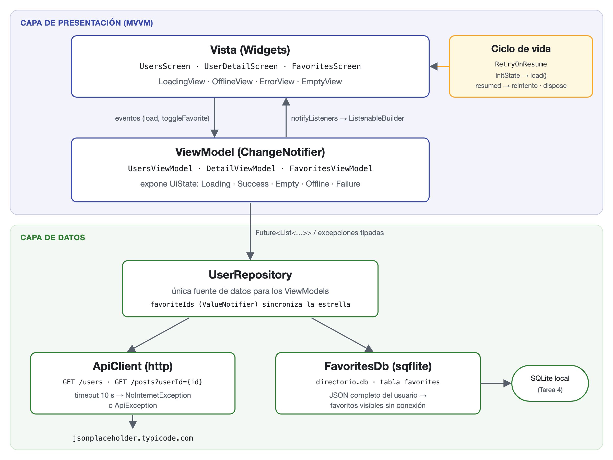
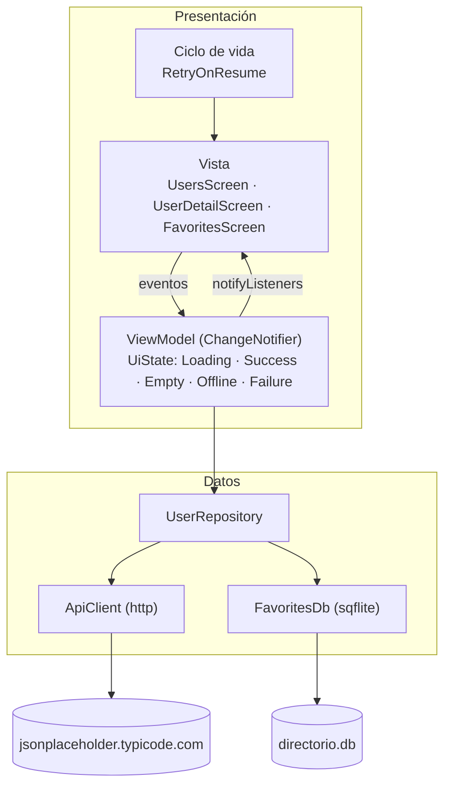

# Arquitectura

La app usa **MVVM por capas**: la vista solo dibuja el estado, el ViewModel decide qué estado mostrar y el repositorio es la única puerta a los datos (red y SQLite). Así cada capa se prueba por separado con dobles de prueba, y el almacenamiento local reutiliza el enfoque offline-first de la Tarea 4. El estado se maneja con `ChangeNotifier` + `ListenableBuilder` de Flutter, sin paquetes extra.

## Capas

| Capa | Archivos | Responsabilidad |
|---|---|---|
| Vista | `lib/ui/users/users_screen.dart`, `lib/ui/detail/user_detail_screen.dart`, `lib/ui/favorites/favorites_screen.dart`, `lib/ui/widgets/` | Dibujar el `UiState` y enviar eventos |
| ViewModel | `lib/ui/*/…_viewmodel.dart`, `lib/ui/ui_state.dart` | Convertir datos y errores en `Loading` / `Success` / `Empty` / `Offline` / `Failure`; ninguna excepción sale de aquí |
| Repositorio | `lib/data/user_repository.dart` | Única fuente de datos; `favoriteIds` sincroniza la estrella entre pantallas |
| Red | `lib/data/remote/api_client.dart` | `GET /users` y `GET /posts?userId={id}` con `http`; solo lanza `NoInternetException` o `ApiException` |
| Persistencia | `lib/data/local/favorites_db.dart` | Favoritos en SQLite con el JSON completo del usuario, para verlos sin conexión |

## Ciclo de vida y carga de datos

| Android | Flutter | Qué pasa con los datos | Código |
|---|---|---|---|
| `onCreate` | `initState` | Primera carga: `load()` en la lista, `loadPosts()` en el detalle | `users_screen.dart:29-33`, `user_detail_screen.dart:45-49`, `retry_on_resume.dart:28-30` |
| `onPause` | `AppLifecycleState.hidden` / `paused` | Sin trabajo de red; se recuerda que la app pasó a segundo plano | `retry_on_resume.dart:45` |
| `onResume` | `AppLifecycleState.resumed` | Si la última carga falló y la pantalla se ve, reintenta sin mostrar el spinner | `retry_on_resume.dart:50-54` |
| `onDestroy` | `dispose` | Se libera el ViewModel y se deja de observar el ciclo de vida | `retry_on_resume.dart:34-35` |

Bajar la barra de notificaciones (`inactive → resumed`) no cuenta como volver a la app, y una pantalla tapada por otra no reintenta.
